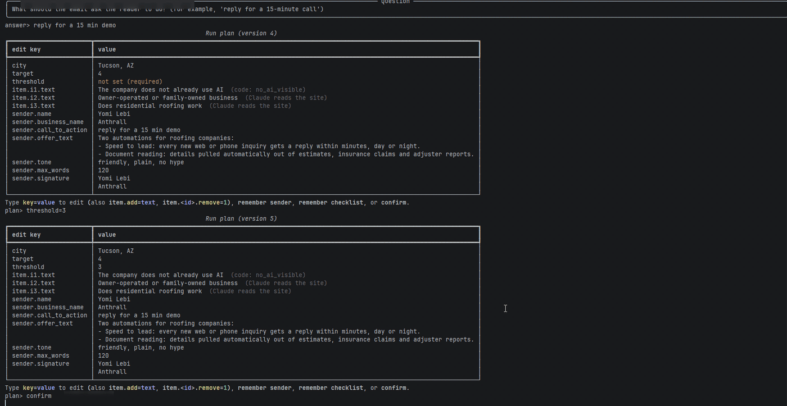
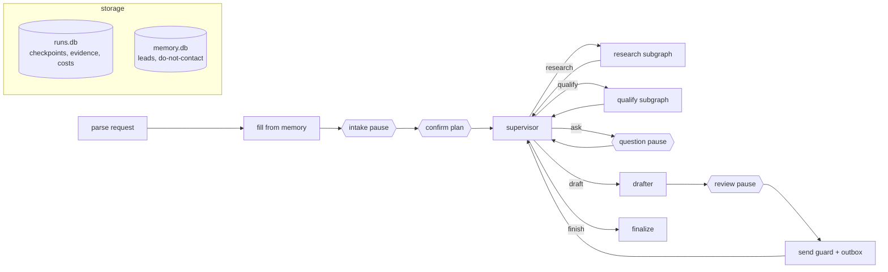

# Outreach Agent

A LangGraph agent that finds local roofing companies, checks each one against a checklist you write, drafts a cold email for each match, and waits for you to approve every draft before anything is sent. Mail goes to a Mailtrap test inbox only.

Python · LangGraph · Claude Opus 5.5 and Haiku 5.5 · Exa search · SQLite · Typer and Rich · LangSmith

302 tests, ruff and mypy clean. A typical run costs about $0.11.



```bash
outreach run "find me leads in Tucson that don't use AI"
```

## Why I built it

I wanted to learn how agent systems hold up outside a notebook. An off-the-shelf lead tool would have done the job and taught me nothing, so I picked a small task that costs real money and fails in real ways: find businesses, check whether they fit, find a contact address that actually exists, and write to them. Then I worked on making the agent safe to stop, crash and resume.

The full design, with the fifteen alternatives I rejected and why, is in [docs/designs/outreach_bot.md](docs/designs/outreach_bot.md).

## What a run looks like

1. You type one sentence. The agent turns it into a plan (city, checklist, how many leads, a points threshold), asks for anything it's missing, and waits for you to confirm or edit it.
2. It searches Exa, throws out directories and listicles, reads each company's own website, and saves quotes, emails and phone numbers.
3. It scores each company against your checklist and picks the best address: an owner's, then a general one like `info@`, then Hunter as a fallback.
4. It shows you each draft to approve, edit, reject or skip. A rejected company goes on a do-not-contact list that every later run respects.
5. Approved drafts go to the sandbox inbox. The end screen shows why the run stopped, how many companies made it through each stage, and what it cost.

You can close the terminal at any point. `outreach resume` brings back the same question, word for word, and nothing you already paid for is called again.

## How it's built



The hexagons are the points where the graph stops for a human. The supervisor picks the next move after every stage.

## Design decisions

### Code computes the legal moves, and Claude picks one

Before each supervisor turn, code works out the legal moves from the database: research, qualify, ask, draft or finish. With `--router claude`, Opus picks one, but its output schema only accepts moves from that list, so it can't skip the approval step or loop forever. Any failure falls back to a plain code router for that turn. Both routers log every decision, and the code router's choice is stored as a "shadow move", so I can compare them run by run.

### The model never reports facts it could invent

Emails are pulled out of fetched pages by code, not by the model. When the Haiku judge says "this is a family-owned roofer", it has to back that with quotes. Code then checks that each quote appears word for word on a page the program actually fetched, and drops claims that fail. One test site contains a prompt injection that tells the model to invent an owner called Bob Smith. The test shows the made-up owner never reaches the database.

### Sending checks the approval itself

The send step makes no assumptions about how it was reached. Before every email it checks five things: an approved review exists, the subject and body hash match what you approved, the company isn't contacted or blocked, the recipient is the test inbox, and the SMTP host is on the allowlist. Any failure is logged as `blocked`, and that draft is never sent.

### Pauses live in nodes that do nothing else

LangGraph re-runs a paused node from its first line when you resume. If a node called Claude and then paused, a resume would make a new call and could ask you a different question. So every pause sits in its own node, and every model call that might be repeated is cached by its exact messages. A test crashes a run halfway through a company and checks that the resumed run makes exactly the same paid calls as one that never crashed.

### Cheap models for bulk work, expensive ones for judgement

Haiku handles parsing, triage, company checks and checklist scoring. Opus handles only the supervisor and the drafts. Every call is logged with its tokens and estimated cost, which is how I know a typical run costs about $0.11 and the worst case, with every limit maxed out, about $1.15.

### Two databases, because the data lives for different lengths of time

`runs.db` holds checkpoints and per-run data and can be deleted between runs. `memory.db` holds what must survive: which companies were seen and where, who is on the do-not-contact list, who was already emailed. It uses numbered migrations and is backed up before each one.

## Things that broke

The plan didn't predict most of these; live runs found them. The full log is in [docs/vendor_notes.md](docs/vendor_notes.md).

- Adding `exa.ai` to Exa's `excludeDomains` list cut search results from 10 to 1 or 2, with no error. Every real run for a whole phase would have found almost nobody. The client now strips it before sending.
- At intake I answered a question with "what do you mean", the agent saved that as my name, and it signed every email with it. Free-text answers now go through Haiku first. If the reply is a question, the agent answers it and asks again.
- The researcher saved the company name one level deep, and the drafter read it from the top level. The canned test data used the flat shape, so no test caught it, and live drafts named the domain instead of the company.
- LangSmith tracing turned itself off. A check that disables tracing when no key is set ran before `.env` was loaded, so it never saw the key. Later, LangSmith's own setup steps added a second destination variable, and the SDK then dropped every trace with only a logged warning. Both are fixed, with a regression test for the first.

## Results

A live research round in Tucson checked 10 companies in 160 seconds for about $0.06, using 6 searches the discovery model wrote itself. A full end-to-end run delivered 8 approved drafts to the Mailtrap sandbox, about 11 seconds apart, and LangSmith grouped the whole run under one thread.

All 302 tests run offline, with network access blocked. Fixture websites stand in for real ones, among them a JavaScript-only shell, a soft 404, a directory page and the prompt-injection site. One opt-in live smoke test makes a real search for about $0.03.

## How I worked

I wrote the design before any code: goals, user journeys, alternatives, a data model and a phased build plan with an exit test for each phase. Then I ran several rounds of structured review against it. I checked every vendor claim against the real API before coding against it, and each phase ended with a live run whose findings went back into the design.

This repo was built locally and published as a single commit on 14 Nov 2026, so the commit history doesn't show the build.

---

## Setup

```bash
uv sync
cp .env.example .env   # then fill in the keys
uv run outreach --help
```

- **Required in `.env`:** `ANTHROPIC_API_KEY`, `EXA_API_KEY`, `MAILTRAP_SMTP_USER`, `MAILTRAP_SMTP_PASS` (the Mailtrap *sandbox* SMTP credentials).
- **Optional:** `HUNTER_API_KEY` (without it, sites with only a contact form end as `no_email`). `LANGSMITH_API_KEY` with `LANGSMITH_AGENT_ID` and `LANGSMITH_AGENT_ENVIRONMENT` turns on tracing. Don't also set `LANGSMITH_PROJECT`: with both set, the SDK traces nothing.
- **`config/settings.toml`:** set your GitHub user in `user_agent`, and `mail_test_recipient` / `mail_from`. Every limit lives here: rounds, searches, the Hunter cap, the target of 4.

Mail can only go to `mail_smtp_host` when it is on `mail_host_allowlist` (the Mailtrap sandbox), and always to `mail_test_recipient`. The company's real address travels in the `X-Intended-Recipient` header.

## Commands

| Command | What it does |
|---|---|
| `outreach run "find me leads in Tucson that don't use AI"` | Start a run. Options: `--router claude\|code`, `--seeds FILE`, `--city "Mesa, AZ"`. |
| `outreach resume` | Resume the unfinished run (also offered by `run`). |
| `outreach discard` | Discard unfinished runs and release their claims. |
| `outreach leads --status parked\|blocked\|contacted` | List companies from `memory.db`, with the city each came from. |
| `outreach purge acme-roofing.com` | Forget a company in both databases, including a do-not-contact entry. |
| `outreach purge Tucson` | Forget every company found in that city. Lists them and asks first; `--yes` skips the question. |

Exit codes: 0 done, 1 error or vendor pause, 2 bad input, 3 config error, 4 version mismatch, 130 Ctrl+C.

To skip searching in round 1, pass your own list of domains: copy [examples/seeds.example.txt](examples/seeds.example.txt) to `examples/my_seeds.txt` (ignored by git), fill it in, and run `outreach run "<prompt>" --seeds examples/my_seeds.txt`.

**Review keys:** `a` approve, `e` edit (opens your editor), `r` reject, `s` skip, `b` back (shown once there's a decision to undo). A reject becomes do-not-contact when review ends; until then, `b` undoes it. If only the draft is bad, use edit. `outreach purge` is the way back.

**Routers:** `--router claude` (the default) lets Opus pick among the legal moves and ask you one question (one more round, a nearby city, a lower threshold). `--router code` uses fixed rules and never asks.

## Data

Both databases live in `%LOCALAPPDATA%\outreach-bot\` (see `runs_db_path` and `memory_db_path`).

- `runs.db`: LangGraph checkpoints and per-run tables (candidates, pages, evidence, drafts, sends, `api_calls`). Safe to delete when no run is in progress.
- `memory.db`: memory across runs (the lead registry with each lead's city, do-not-contact, contacted, remembered answers). Backed up to `memory.db.bak-<version>` before each migration.

A crash writes `trace-<run_id>.txt` next to `runs.db`.

## Tests

```bash
uv run pytest
uv run ruff check .
uv run mypy
```

Network access is blocked in tests. The one exception is the opt-in live smoke test (one real search, two companies, about $0.03, nothing mailed):

```bash
OUTREACH_LIVE=1 uv run pytest tests/live -s
```

## Windows note

Antivirus HTTPS scanning (Norton here) breaks Python's TLS in two ways. `outreach/tls.py` handles both at startup: it uses the Windows trust store (`truststore`), and drops an `SSLKEYLOGFILE` that points at a named pipe.
